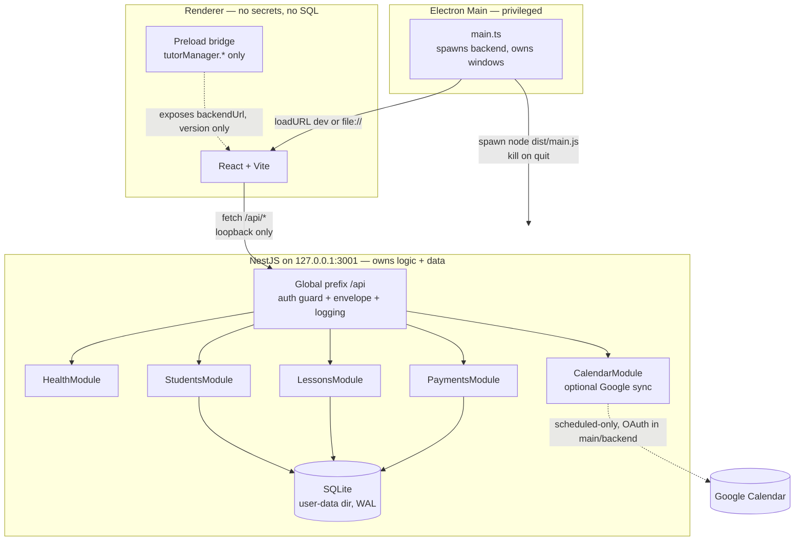

# Tutor Manager — Architecture

Offline-first desktop app for individual tutors. Single-user, local-first: SQLite is the source of truth, NestJS owns all business logic, React is a thin client, Electron is a shell that spawns and loads them.



Packaged layout: Electron resources contain `frontend/dist` (loaded via `file://`) and `backend/dist` (spawned as child). SQLite lives in the OS user-data dir, never inside the install dir.

## React — presentation + state

- `apps/frontend/src/`: `components/` (pure views), `pages/`, `api/` (typed HTTP client over shared contracts), `state/` (per-page hooks; no global store until 3+ pages share mutable state — `ponytail: ceiling 3 shared pages, upgrade to zustand`).
- Rules: no `sqlite`/`better-sqlite3`/`prisma` imports, no Google tokens, no business math (billing, minutes) — all in NestJS. Renderer calls `fetch` against `/api` (dev proxy) or `window.tutorManager.backendUrl` (packaged).
- Data flow: page hook → `api/*` client (shared DTO types) → NestJS → re-render from `ApiResponse<T>`.

## NestJS — modules, controllers, services, repositories

Layered per module, one direction only:

`controller (DTO in/out) → service (rules) → repository (SQL only) → SQLite`

Planned modules (only `HealthModule` exists today; others follow this shape):

| Module | Controller | Service rules | Repository |
|---|---|---|---|
| Health | `GET /api/health` | liveness, no DB required | none |
| Students | `/api/students` CRUD | validate input, no silent delete | `students` table |
| Lessons | `/api/lessons` CRUD + complete | scheduled/actual/bonus/billable minutes, tuition snapshot | `lessons` table |
| Payments | `/api/payments` CRUD | integer VND, no negative totals | `payments` table |
| Calendar | `/api/calendar/*` status/connect/sync | scheduled-only payload, conflict preserve | `calendar_links` table |

Dependency rules:

- Controllers never import repositories directly.
- Services never import controllers.
- Repositories never import services; only SQL + row mapping.
- `CalendarModule` never imports Students/Lessons services — it receives a scheduled-lesson payload, never tuition/payment fields.
- Shared package holds DTOs only — no NestJS, no Electron, no React imports.

```
apps/backend/src/
  main.ts            # bootstrap: prefix, CORS, guard, filter, logging
  app.module.ts      # imports feature modules only
  common/            # envelope, guard, filter, logger (no domain logic)
  health/
  students/          # .controller.ts / .service.ts / .repository.ts / dto/
  lessons/
  payments/
  calendar/
  config.ts          # validated env (HOST, PORT, DATA_DIR)
```

## Electron — main vs preload

- `apps/desktop/src/main.ts` (privileged): spawns `backend/dist/main.js`, creates `BrowserWindow` with `contextIsolation: true, nodeIntegration: false`, kills backend on quit. Owns OAuth window flow if ever needed — tokens stay in main/backend.
- `apps/desktop/src/preload.ts` (narrow bridge): exposes only `window.tutorManager.getBackendUrl()` / `getVersion()` / `pingBackend()` via `contextBridge` + `ipcRenderer.invoke`. Main validates every IPC sender frame against the allowed app URL. No `ipcRenderer` passthrough, no `shell`, no tokens, no SQL.
- Renderer never sees `process`, `require`, or OAuth secrets. Any new bridge method needs an ADR update.

## SQLite persistence

- One file in OS user-data dir (`app.getPath('userData')/tutor-manager.sqlite`, WAL mode). Dev override via `DATA_DIR`.
- Access only from NestJS repositories (Prisma via `PrismaService` + better-sqlite3 adapter).
- DB file: `DATA_DIR/tutor-manager.db` (`./data` dev, Electron `userData` packaged). WAL mode, `foreign_keys=ON`, `busy_timeout=5000`.
- Migrations: generated by `prisma migrate dev` (`prisma/migrations/*.sql`); applied at boot by `src/db/migrations.ts` (tracked in `schema_migrations`) so packaged apps migrate without the schema engine. `dist/prisma/migrations` is copied at build (`postbuild`).
- Dev CLI: `pnpm --filter @tutor-manager/backend db:migrate`, `db:seed` (fictional data), `db:generate`.
- Conventions: money = integer VND, durations = integer minutes, timestamps = ISO UTC text, historical tuition snapshotted on lesson completion, migrations only (never `db push` on user data, never delete user DB to fix migrations).
- Seed fixtures use fictional data only.

## Shared DTOs and contracts

`packages/shared/src/`: framework-free types + `ApiResponse<T>` envelope + error codes. Every public endpoint has a contract in `docs/API-SPEC.md` with matching TS types in shared. Frontend and backend import types from `@tutor-manager/shared` — never duplicate shapes.

## Local API authentication

Single-user loopback trust model (no multi-user accounts):

1. On first backend boot, generate a random 256-bit token, store in OS-secured storage (user-data file mode `0600`; OS keychain when available).
2. Electron main reads it and injects as `Authorization: Bearer` for health checks; renderer receives it only in memory via the preload bridge at startup — never persisted in localStorage, never logged.
3. Backend `LocalAuthGuard` accepts: valid bearer token OR `Origin` in allowlist with `Host: 127.0.0.1` (dev convenience). Packaged app requires the token.
4. CORS allowlist: dev Vite origins + `file://` (packaged). Bind host is always `127.0.0.1`; never `0.0.0.0`.

`ponytail: ceiling single-user local; upgrade to per-install pairing + keychain when multi-device appears.`

## Error handling and structured responses

Every response is `ApiResponse<T>`: `{ ok, data?, error? }` with `{ code, message, details? }`. HTTP status mirrors the code (`400 VALIDATION`, `401 UNAUTHORIZED`, `404 NOT_FOUND`, `409 CONFLICT`, `422 BUSINESS_RULE`, `500 INTERNAL`). Business-rule violations (e.g. completing an already-completed lesson, conflicting calendar edit) return `409/422` with the preserved record — never silent overwrite/delete. Global exception filter maps unknown errors to `INTERNAL` without leaking stacks.

## Logging and configuration

- Backend: structured JSON lines (`time, level, module, msg, requestId`), request ID per call, log to stdout in dev and rotating file in user-data dir when packaged. No student PII beyond IDs, no tokens, no payment amounts above debug level.
- Config: `HOST` (default `127.0.0.1`, never overridden to public), `PORT` (default `3001`), `DATA_DIR`, `LOG_LEVEL`. Validated at boot in `config.ts`; fail fast on invalid.
- Frontend: `VITE_API_URL` for browser-dev only; packaged build uses the preload bridge.

## Compatibility and invariants

- No circular module dependencies (feature modules import `common/` only, never each other except via explicit payload types).
- No direct SQLite access from React (no DB deps in `apps/frontend/package.json` — audit in CI).
- No Google tokens in the renderer (OAuth code exchange in backend, refresh token in backend store).
- Every public API has a documented contract in `docs/API-SPEC.md` + shared types.
- Packaged app works fully offline with no Google account; Google sync is opt-in per Settings and scheduled-info-only.
